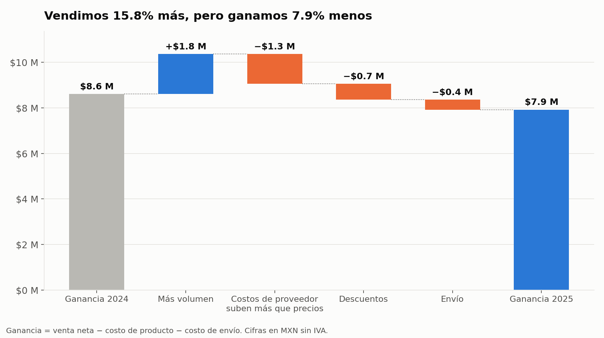
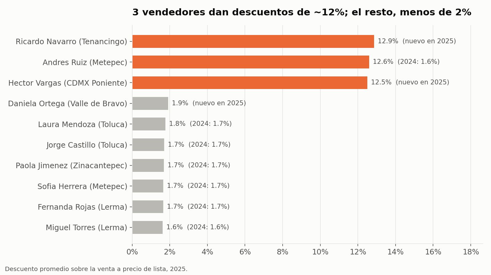
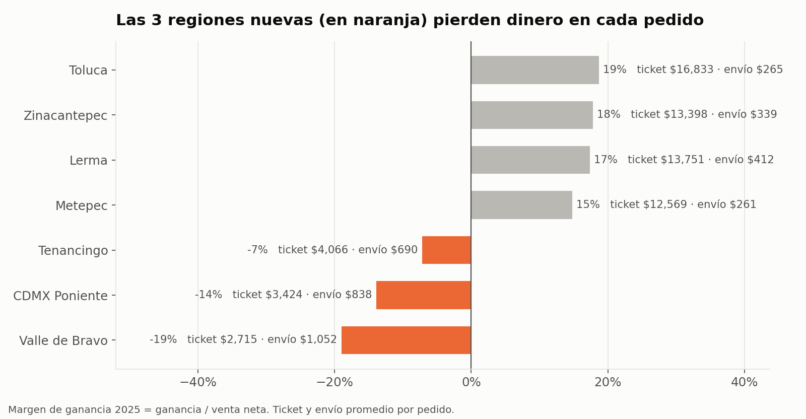
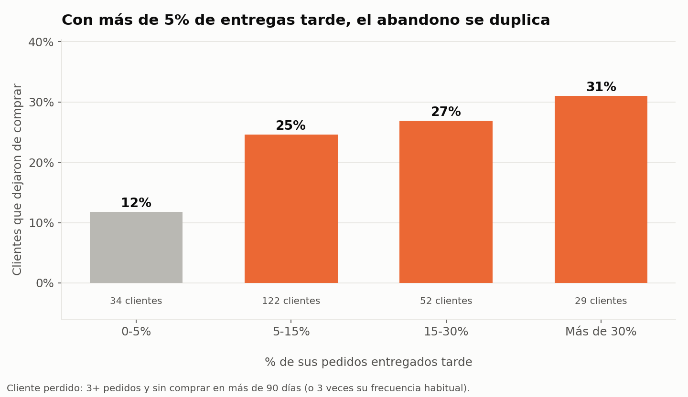
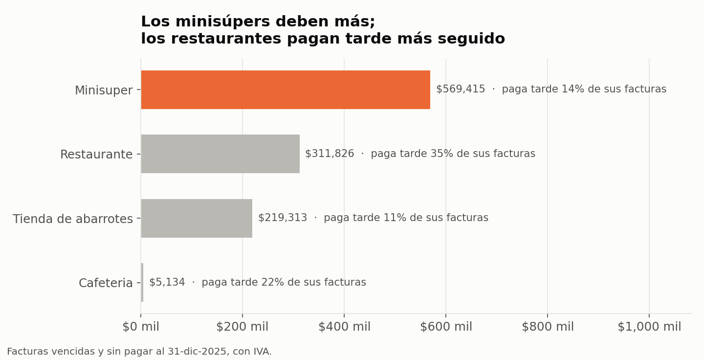

# Distribuidora Andina · ¿Por qué vendemos más pero ganamos menos?

> **Reporte ejecutivo de rentabilidad 2024–2025** · Python (pandas, Seaborn) · Excel (Power Query, XLOOKUP, tablas dinámicas) · Git
>
> **Autor:** Jacobo Gómez Montoya · [LinkedIn](https://www.linkedin.com/in/jacobo-gomez-automation) · Toluca, México
>
> ⚠️ *Empresa y datos simulados con fines de portafolio. Las cifras ilustran la metodología y no describen una empresa real.*

---

## TL;DR

En 2025 la distribuidora **vendió 15.8% más, pero ganó 7.9% menos**. El crecimiento no se perdió en un solo lugar, sino en cuatro:

1. **Los costos de los proveedores subieron más que nuestros precios.** Es la fuga más grande: −$1.3 M.
2. **3 vendedores dan descuentos de ~12.5%**, contra menos de 2% del resto: −$0.7 M.
3. **La expansión a 3 regiones lejanas pierde dinero en cada pedido**, porque son pedidos chicos con envío caro.
4. **Las entregas tarde se dispararon** (del 6% al 16%), y los clientes con retrasos dejan de comprar el doble.

Ninguna de estas fugas se ve en el reporte de ventas. Solo aparecen cuando se mide la **ganancia por pedido después del costo de envío**.

---

## 1. El problema de negocio

Distribuidora Andina es un mayorista de abarrotes, bebidas, limpieza e higiene en el Valle de Toluca. Vende a **tiendas de abarrotes, minisúpers, restaurantes y cafeterías**, y reparte con flotilla propia.

La dirección celebró el cierre de 2025: **$47.8 M en ventas netas, +15.8%**. Pero el estado de resultados dijo otra cosa:

| | 2024 | 2025 | Cambio |
|---|---|---|---|
| Venta neta | $41.3 M | $47.8 M | **+15.8%** |
| Margen bruto (venta − costo de producto) | $9.5 M | $9.3 M | −2.6% |
| Costo de envío | $0.9 M | $1.4 M | +47.1% |
| **Ganancia** (margen bruto − envío) | **$8.6 M** | **$7.9 M** | **−7.9%** |

> **Pregunta:** ¿dónde se está yendo la ganancia que debería traer el crecimiento?

---

## 2. Hallazgos clave

### 🔎 Hallazgo 1: el puente de la ganancia muestra 4 fugas



- El mayor volumen **sí aportó +$1.76 M**, así que la estrategia de crecer funcionó en ventas.
- Pero se lo comieron cuatro fugas:
  - **Costos de proveedor** que subieron 6–9% mientras los precios de lista solo subieron 3–5%: **−$1.31 M**.
  - **Descuentos:** −$0.69 M.
  - **Envío**, por el diésel más caro y las rutas más largas: −$0.44 M.
- **Resultado:** $0.68 M menos de ganancia que en 2024.

### 💸 Hallazgo 2: tres vendedores explican el salto en descuentos



- Siete vendedores mantienen descuentos de **1.6–1.9%**, igual que en 2024.
- **Andrés Ruiz (Metepec)** pasó de 1.6% a **12.6%**: sus descuentos subieron de $55 mil a **$494 mil** en un año.
- Los dos vendedores nuevos de la expansión, **Ricardo Navarro (Tenancingo)** y **Héctor Vargas (CDMX Poniente)**, arrancaron dando **~12.5%**.
- **Implicación:** no es un problema de toda la fuerza de ventas, sino de 3 personas sin un tope de descuento.

### 🗺️ Hallazgo 3: la expansión 2025 pierde dinero en cada pedido



- Las 4 regiones originales ganan **15–19%** sobre la venta.
- Las 3 regiones nuevas **pierden entre 7% y 19%** en cada pedido.
- **La causa no es el precio, sino la logística:** en Valle de Bravo el pedido promedio es de **$2,715** y llevarlo cuesta **$1,052**. En Toluca, el pedido promedio es de $16,833 y el envío cuesta $265.
- En 2025, **44 de 227 clientes** dejaron pérdida; en cambio, **el 20% de los clientes genera el 69% de la ganancia**.

### 🚚 Hallazgo 4: las entregas tarde están costando clientes



- Las entregas tarde pasaron de **6.3% en 2024 a 16.3% en 2025**: la flotilla no creció al ritmo de la expansión.
- Clientes con **0–5%** de entregas tarde: **12%** dejaron de comprar.
- Clientes con **más de 5%** de entregas tarde: **25–31%** dejaron de comprar, más del doble.

### 🧾 Hallazgo 5: la cobranza tiene dos problemas distintos



- Los **minisúpers** concentran la mayor deuda vencida (**$569 mil**), porque compran mucho y a crédito de 15–30 días.
- Los **restaurantes** son los que **más veces pagan tarde (35% de sus facturas)**, aunque deben menos en total.
- **Implicación:** con los minisúpers conviene revisar los límites de crédito; con los restaurantes, el seguimiento de cobranza.

---

## 3. Recomendaciones para la dirección

### 1️⃣ Proteger el margen comercial: precios y descuentos
- **Qué:** actualizar la lista de precios en las categorías donde el costo subió más de 5%, y poner un **tope de descuento de 3%** que solo la gerencia pueda superar.
- **Por qué:** son las dos fugas más grandes (−$2.0 M juntas) y dependen solo de decisiones internas.
- **Impacto potencial:** llevar a los 3 vendedores al descuento promedio del resto recuperaría **cerca de $0.5 M al año**, si se mantiene el volumen.
- **KPI:** descuento promedio por vendedor (meta menor a 3%) y margen bruto % mensual.

### 2️⃣ Hacer rentable la expansión: pedido mínimo o cargo de envío
- **Qué:** en Tenancingo, Valle de Bravo y CDMX Poniente, fijar un **pedido mínimo de ~$6,000** o cobrar el envío en pedidos menores. Además, **agrupar entregas por ruta** en días fijos.
- **Por qué:** estas zonas pierden dinero porque se envían pedidos chicos a zonas lejanas, no por falta de demanda.
- **KPI:** ganancia por pedido en regiones nuevas (meta mayor que 0) y ticket promedio.

### 3️⃣ Recuperar el nivel de servicio en las entregas
- **Qué:** medir cada semana el **% de entregas a tiempo por ruta**, y activar una alerta cuando un cliente acumule 2 entregas tarde en un mes. Evaluar una unidad adicional de reparto para las rutas nuevas.
- **Por qué:** cuando un cliente pasa de 5% de entregas tarde, el abandono se duplica. Perder clientes cuesta más que el camión.
- **KPI:** entregas a tiempo (meta de 95% o más) y tasa de abandono de clientes.

---

## 4. Cómo se hizo

### Datos
Son 6 archivos CSV simulados en `datos_crudos/`: ventas (34,649 líneas), productos (90), clientes (241), vendedores (10), entregas y pagos (6,702 pedidos). Vienen **"sucios" a propósito**, como llegan de un sistema real:
- **207 líneas de venta duplicadas.**
- **Espacios de más en `cliente_id`**, lo que rompe las búsquedas.
- **La región escrita de 27 formas distintas** ("TOLUCA", " metepec ", "Cdmx Poniente"…) para solo 7 regiones reales.
- **Fechas y montos guardados como texto** en pagos ("$1,234.50", "31/12/2025").

### Excel · `excel/distribuidora_andina.xlsx`

| Hoja | Qué contiene | Habilidad |
|---|---|---|
| `ventas`, `clientes` | Consultas de **Power Query** que importan los CSV crudos: quitan espacios, eliminan duplicados, unifican las 27 variantes de región en 7 y asignan tipos de dato | Power Query |
| `ventas` (columnas K–O) | **XLOOKUP / BUSCARX** que trae categoría, costo del producto (2024 o 2025 según el año de la venta), región, tipo de cliente y vendedor | XLOOKUP |
| `tablas_dinamicas` | Margen bruto por región y año · Descuentos por vendedor y año | Tablas dinámicas |
| `conciliacion` | Comparación de 8 totales de Excel contra Python | Pensamiento crítico |

### Python · `analisis.py`
El mismo pipeline en pandas: limpieza, unión de las 6 tablas, ganancia por pedido **después del envío** (Excel solo llega al margen bruto), puente de ganancia, Pareto de clientes, análisis de abandono y cobranza, y los 5 gráficos en Seaborn/Matplotlib.

### ✅ Conciliación: ¿Excel y Python dicen lo mismo?
Se calculó todo **dos veces, por caminos independientes**, y se compararon los resultados:

| Métrica | 2024 | 2025 |
|---|---|---|
| Venta neta, descuentos, costo y margen bruto | ✅ Coinciden al centavo | ✅ Coinciden al centavo |
| Líneas de venta después de limpiar | 34,442 en ambos | |
| Búsquedas XLOOKUP sin coincidencia | 0 | |

> **Lección de limpieza:** si se eliminan duplicados *antes* de quitar espacios, solo se detectan 194 de los 207, porque las copias que difieren por un espacio parecen distintas. El orden de los pasos cambia el resultado, así que en Power Query y en pandas se hace primero el recorte de espacios y después la eliminación de duplicados.

---

## Cómo reproducirlo

Primero crea el entorno virtual:
```bash
python3 -m venv .venv
```
Actívalo:
```bash
source .venv/bin/activate
```
Instala las dependencias:
```bash
pip install -r requirements.txt
```
Genera los datos crudos (semilla fija, siempre salen iguales):
```bash
python generar_datos.py
```
Corre el análisis, que crea `datos_limpios/`, `graficos/` y `resultados.json`:
```bash
python analisis.py
```

Para Excel: abre `excel/distribuidora_andina.xlsx`. Si mueves la carpeta, actualiza la ruta de los CSV en **Datos → Obtener datos → Editor de Power Query** y pulsa **Actualizar todo**.

## Estructura

```
├── generar_datos.py          # Simula 2 años de operación con datos "sucios"
├── analisis.py               # Limpieza, análisis y gráficos (pandas + Seaborn)
├── crear_excel_base.py       # Libro base con catálogos
├── datos_crudos/             # 6 CSV de origen
├── excel/                    # Power Query + XLOOKUP + tablas dinámicas + conciliación
├── graficos/                 # 5 gráficos del reporte
└── resultados.json           # Métricas calculadas en Python
```

---

*Proyecto de práctica de análisis de datos, construido con Python, Excel y apoyo de Claude Code, como parte de mi formación en Data Analytics.*
